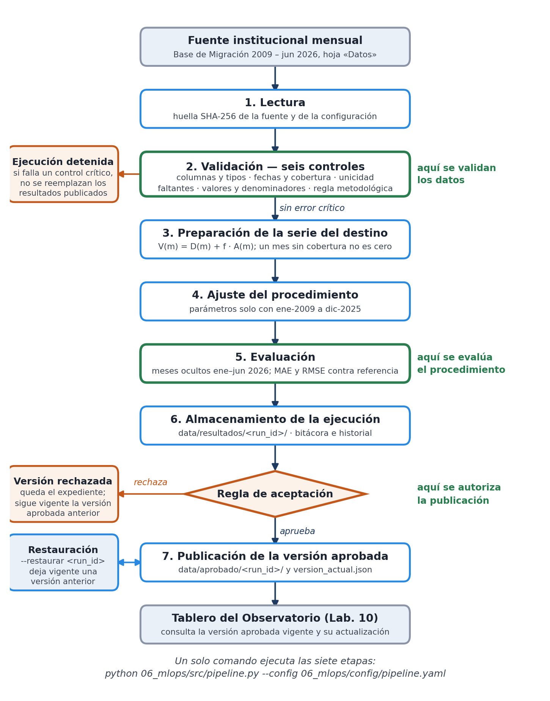

# 06 — Flujo MLOps del Observatorio (Laboratorio 11)

Flujo reproducible que estima el ingreso mensual de viajeros internacionales al destino
**Petén / Mundo Maya** y publica una versión aprobada para que la consulte el tablero del
Laboratorio 10.

Entrega completa del Laboratorio 11: alcance, diagrama, pipeline reproducible, los seis controles
de calidad, registro de ejecuciones en MLflow, integración con el tablero, monitoreo y
recuperación, y despliegue local con Docker.

*Datos de uso exclusivamente académico; no son cifras oficiales del INGUAT ni del IGM.*

## Alcance del flujo

| | |
|---|---|
| **Variable estimada** | `viajeros_destino`: viajeros internacionales que ingresan al destino en el mes |
| **Unidad** | viajeros por mes |
| **Nivel de agregación** | mes × destino |
| **Fuente** | `data/raw/Base_Migracion_2009-2026jun.xlsx`, hoja `Datos` (fuente mensual) |
| **Columnas usadas** | `Año`, `Mes cod`, `Vía`, `Frontera`, `País`, `Región dos`, `Tipo de Viajero`, `Viajero` |
| **Cobertura** | ene-2009 a jun-2026 (210 meses) |
| **Período de ajuste** | ene-2009 a dic-2025 (204 meses) |
| **Período de evaluación** | ene-2026 a jun-2026 (6 meses ocultos del ajuste) |
| **Archivo que lee el tablero** | `data/aprobado/version_actual.json` → `data/aprobado/<run_id>/estimaciones.csv` |

### El procedimiento de estimación

```
V(m) = D(m) + f · A(m)
```

- `D(m)` — entradas observadas en los puestos de entrada del propio destino: `02 Mundo Maya`,
  `17 El Naranjo`, `18 Bethel` y `20 Melchor de Mencos`, para los tipos *Turista* y *Excursionista*.
- `A(m)` — turistas que ingresan por `01 La Aurora` (vía aérea) y pueden continuar al destino.
- `f` — **factor de reparto**: proporción de esos turistas que visita el destino.

`D` y `A` se calculan sobre conjuntos de registros **disjuntos**, así que ningún viajero se cuenta
dos veces; el control 6 lo verifica en cada ejecución. Las conexiones domésticas La Aurora → Flores
no aparecen en la base de migración, de modo que sumarlas por separado no duplicaría registros,
pero sí duplicaría personas: por eso el término indirecto se estima con un factor menor que 1 en
lugar de sumar otra serie observada.

### Supuestos declarados

- **`factor_reparto = 0.12`** es un supuesto del observatorio, no un parámetro estimado de los
  datos. Es provisional y está pendiente de calibrar con el registro de visitantes del Parque
  Nacional Tikal (IDAEH). La configuración declara además un rango de sensibilidad (0.08 – 0.18) y
  el control 6 advierte si el valor usado queda fuera.
- Se excluye el tipo de viajero *Viajero*, cuyo criterio de registro cambió en 2023, y *Cruceristas*,
  que no ingresa por los puestos del destino.
- Un mes del rango de cobertura sin información **no se convierte en cero**: queda vacío y el
  control 2 lo reporta.

## Diagrama del flujo



Se genera con `python 06_mlops/src/diagrama.py`, para que la figura del informe corresponda siempre
al pipeline implementado. Marca los tres puntos que pide el enunciado: dónde se **validan los
datos** (etapa 2), dónde se **evalúa el procedimiento** (etapa 5) y dónde se **autoriza la
publicación** (regla de aceptación, antes de la etapa 7).

## Cómo ejecutarlo

```bash
pip install -r 06_mlops/requirements.txt

# flujo completo: lectura → validación → preparación → ajuste → evaluación → almacenamiento → publicación
python 06_mlops/src/pipeline.py --config 06_mlops/config/pipeline.yaml

# solo lectura y controles de calidad
python 06_mlops/src/pipeline.py --solo-validar

# ejecuta todo sin tocar la versión aprobada
python 06_mlops/src/pipeline.py --sin-publicar

# deja vigente una versión aprobada anterior
python 06_mlops/src/pipeline.py --restaurar 20261103T032329Z-3399-descono

# pruebas
python -m pytest 06_mlops/tests -q
```

`--config` es opcional: sin él se usa `06_mlops/config/pipeline.yaml`. Los datos institucionales se
pueden montar fuera del repositorio con la variable de entorno `OBS_DATOS_CRUDOS`, que tiene
prioridad sobre la ruta de la configuración (así no entran en la imagen Docker de la entrega final).

Nada se edita a mano entre etapas y nada depende del estado de una sesión: las únicas entradas son
el archivo de configuración y las fuentes que este declara. Cambiar un filtro en el tablero no
vuelve a ajustar el procedimiento, porque el tablero solo lee el archivo publicado.

## Los seis controles de calidad

| # | Control | Qué verifica | Advierte cuando | Detiene cuando |
|---|---|---|---|---|
| 1 | `columnas_tipos` | columnas indispensables presentes y con tipo compatible | aparece una columna no declarada (cambio de estructura) | falta una columna indispensable o una no admite su tipo |
| 2 | `fechas_cobertura` | `Año`/`Mes cod` forman fechas válidas; todos los meses de la cobertura traen información | hay meses fuera del rango, o meses sin cobertura dentro del umbral | hay fechas inválidas, o los meses sin cobertura superan `max_meses_sin_cobertura` |
| 3 | `unicidad` | sin filas repetidas según la clave que define la granularidad | hay duplicados por debajo de `max_prop_duplicados` | la proporción de duplicados supera ese umbral |
| 4 | `valores_faltantes` | sin ausencias en las columnas necesarias para estimar | una columna de ausencia permitida supera `max_prop_nulos_permitidos` | falta un valor en una columna indispensable |
| 5 | `valores_denominadores` | conteos no negativos y finitos; denominador del reparto distinto de cero | el denominador es cero en un mes fuera del período evaluado | hay conteos negativos o no finitos, o el denominador es cero o falta dentro del período evaluado |
| 6 | `regla_metodologica` | serie mensual de fuente mensual; sin duplicar visitantes; factor de reparto en (0, 1] | el factor queda fuera del rango de sensibilidad declarado | la fuente trae granularidad diaria, un año supera 12 meses, los puestos del destino y el del reparto se solapan o faltan, o el factor está fuera de (0, 1] |

El nivel de cada control (`critico` o `advertencia`) está en la configuración, no en el código. Los
seis corren siempre, aunque uno falle, para que el reporte describa el estado completo de la fuente;
quien decide detenerse es el pipeline. Un control que lanza una excepción queda en error: **un
control roto nunca aprueba una versión.**

El resultado se escribe en `controles.csv` de cada ejecución, con una fila por control: qué verifica,
nivel, estado, si detuvo la ejecución, filas afectadas y detalle.

## Regla de aceptación

Se evalúa en este orden y basta que una condición falle para rechazar la versión candidata:

1. ningún control crítico en error;
2. salidas completas: una fila por mes de evaluación, sin valores vacíos ni no finitos;
3. `MAE ≤ 12 000` viajeros/mes;
4. error relativo (`MAE` / promedio observado del período) `≤ 35 %`.

Superar a la referencia **no** es obligatorio: la condición existe en la configuración
(`mejor_o_igual_que_referencia`) y está en `false`. Los umbrales se justifican por la escala de la
serie: el destino promedia unos 24 000 viajeros/mes, así que 12 000 es la mitad del volumen típico y
35 % es holgado frente al 13 % que alcanza el procedimiento actual, pero rechaza una degradación
evidente. La regla se aplica tal como está escrita y no se modifica después de ver los resultados.

## Resultados del avance

Dos ejecuciones completas con los mismos datos y la misma configuración
(`20261103T032329Z-3399-descono` y `20261030T050712Z-3df2-942c1b0`):

| | Procedimiento (Holt-Winters) | Referencia (promedio histórico) |
|---|---|---|
| MAE | 3 110.0 | 4 264.4 |
| RMSE | 3 669.0 | 4 760.2 |
| Error relativo | 12.9 % | 17.8 % |

Las dos ejecuciones produjeron estimaciones **idénticas** (diferencia máxima 0.0, por debajo de la
tolerancia configurada de 1e-6): los procedimientos usados son deterministas y la semilla queda
fijada igual.

### Hallazgo: la clave declarada no coincidía con la granularidad de la fuente

El control 3 detuvo la primera ejecución con 42 filas duplicadas. No eran filas repetidas: el mismo
país aparece en dos valores distintos de `Agrupación Residencia` en 20 combinaciones de 2020–2022, así
que la clave de la granularidad incluye esa columna. Se corrigió la configuración, no los datos. Es
el tipo de problema que el control existe para detectar: sin él, agregar la serie habría sumado sin
avisar registros que la fuente distingue.

## Estructura

```
06_mlops/
├── config/pipeline.yaml   rutas, períodos, parámetros, umbrales y niveles de control
├── src/
│   ├── pipeline.py        orquestador: un comando corre las siete etapas
│   ├── config.py          carga y valida la configuración; huellas y commit de Git
│   ├── ingesta.py         etapa 1: lectura de las fuentes
│   ├── validaciones.py    etapa 2: los seis controles de calidad
│   ├── preparacion.py     etapa 3: serie del destino y factor de reparto
│   ├── modelo.py          etapa 4: ajuste (reutiliza el Laboratorio 1) y referencia
│   ├── evaluacion.py      etapa 5: métricas y regla de aceptación
│   ├── publicacion.py     etapas 6 y 7: expediente, publicación y restauración
│   ├── registro.py        run_id, bitácora por ejecución e historial
│   ├── seguimiento.py     registro de cada ejecución en MLflow Tracking
│   ├── monitoreo.py       las tres verificaciones de monitoreo, sobre el historial
│   └── diagrama.py        genera la figura del flujo
├── tests/                 61 pruebas: controles, flujo, fallo/recuperación, monitoreo
├── data/
│   ├── resultados/<run_id>/   expediente de cada ejecución (aprobada o no)
│   ├── aprobado/<run_id>/     versiones aprobadas conservadas
│   ├── aprobado/version_actual.json   puntero a la versión vigente
│   └── historial_ejecuciones.jsonl    una línea por ejecución
├── logs/<run_id>.log      bitácora: inicio, fin, etapas, advertencias, errores, publicación
├── mlruns/                base SQLite de MLflow + artefactos (persiste fuera de Docker)
├── Dockerfile             imagen del pipeline y del monitoreo
├── requirements.txt
├── codebook.md
└── README.md
```

## Registro en MLflow Tracking (ejercicio 4)

Cada ejecución crea (o reutiliza) el experimento `observatorio-peten-mundo-maya` y registra un run
con: identificador y commit de Git (tags), huella de la fuente y de la configuración, períodos de
ajuste y evaluación, parámetros del procedimiento (incluido el factor de reparto), parámetros
ajustados del modelo, métricas de evaluación, resumen de los controles de calidad, resultado de la
regla de aceptación y el expediente completo (`estimaciones.csv`, `metricas.csv`, `controles.csv`,
`metadatos.json`, `pipeline.yaml`) como artefactos. Se registra también cuando la ejecución se
rechaza, se detiene o falla — la causa queda en las tags y en los artefactos, nunca se inventan
métricas para una evaluación que no llegó a correr.

El registro es un efecto adicional: si MLflow no está disponible, queda como advertencia en la
bitácora y el pipeline sigue (los resultados locales no dependen de MLflow).

```bash
# tracking local (SQLite en 06_mlops/mlruns/) y consulta con la interfaz web
python 06_mlops/src/pipeline.py
mlflow ui --backend-store-uri sqlite:///06_mlops/mlruns/mlflow.db
```

Dos ejecuciones con los mismos datos y configuración (ver `06_mlops/mlruns/`) registran MAE y RMSE
idénticos: `MAE=3,110.0`, `RMSE=3,669.0`, `error_relativo=0.1295`, `fuente_sha256` igual en ambas,
lo que confirma la reproducibilidad del procedimiento (determinista, semilla fija).

## Integración con el tablero (ejercicio 5)

El tablero del Laboratorio 10 (`05_dashboard_interactivo`) agrega la página **Petén / Mundo Maya**
(`src/app_pages/peten.py`), que lee únicamente `06_mlops/data/aprobado/version_actual.json` y la
carpeta que señala — nunca ejecuta el pipeline ni ajusta nada. Muestra:

- la fecha de la última actualización y la versión del procedimiento;
- el error típico de validación (MAE) con una explicación breve de qué significa y sobre cuántos
  meses se calculó;
- una gráfica con lo **observado** (línea azul sólida) y lo **estimado** (línea naranja punteada)
  para el mismo mes, siguiendo el significado de color fijo del documento de diseño del Lab. 10;
- una advertencia sobre las limitaciones del factor de reparto.

Si todavía no existe una versión aprobada, la página lo dice explícitamente
("las estimaciones no están disponibles") en vez de mostrar datos vacíos o inventados. Los detalles
técnicos (parámetros, huellas, commit) quedan en MLflow y en `06_mlops/`, no en la interfaz.

## Monitoreo y recuperación (ejercicio 6)

```bash
python 06_mlops/src/monitoreo.py --config 06_mlops/config/pipeline.yaml
```

Lee el historial de ejecuciones y compara la última corrida contra la versión aprobada vigente,
sin volver a tocar la fuente. Tres verificaciones (`06_mlops/src/monitoreo.py`):

| Verificación | Qué compara | Genera alerta cuando |
|---|---|---|
| `actualizacion` | último mes estimado vs. `monitoreo.mes_esperado` | la fuente o las estimaciones no llegan al período esperado |
| `calidad` | `controles.csv` de esta ejecución vs. la versión aprobada anterior | aparece un control en error que antes pasaba (o sigue en error) |
| `resultados` | estimaciones negativas/no finitas y variación mes a mes contra el umbral configurado | hay valores inválidos o una variación sobre `monitoreo.variacion_mensual_max` |

Una variación alta genera una alerta para revisión; por sí sola no concluye que el procedimiento
perdió precisión, y el error predictivo (MAE/RMSE) solo se actualiza cuando hay observación
comparable — igual que en la etapa de evaluación.

**Prueba controlada de fallo y recuperación** (con datos sintéticos, `tests/test_pipeline.py` y
`tests/test_monitoreo.py`): se publica una versión aprobada; se introduce un problema (columna
ausente, clave duplicada, denominador en cero); se corre el pipeline y se comprueba que (a) el
control correspondiente lo detecta, (b) el pipeline se detiene sin reemplazar lo publicado, (c) la
versión aprobada anterior sigue disponible, (d) el monitoreo de calidad marca el control nuevo en
error. Se corrige el problema y se vuelve a ejecutar: la nueva versión se aprueba y se publica.

**Restauración de una versión anterior:**

```bash
python 06_mlops/src/pipeline.py --restaurar 20261103T030301Z-b930-45ad69b
```

Reescribe únicamente el puntero `version_actual.json`; no copia ni regenera nada, así que es
inmediata y el tablero la consulta en la siguiente recarga.

## Docker (ejercicio 7)

```bash
docker compose up -d --build        # levanta mlflow (puerto 5000) y el tablero (puerto 8501)
docker compose run --rm pipeline    # corre el flujo una vez
docker compose run --rm monitor     # corre el monitoreo sobre la última ejecución
docker compose down                 # detiene los servicios; los datos persisten
```

| Servicio | Qué hace | Puerto |
|---|---|---|
| `mlflow` | servidor de MLflow Tracking (backend SQLite) | 5000 |
| `pipeline` | corre `06_mlops/src/pipeline.py` una vez (perfil `tools`, no se levanta con `up`) | — |
| `monitor` | corre `06_mlops/src/monitoreo.py` una vez (perfil `tools`) | — |
| `tablero` | tablero Streamlit, incluida la página Petén / Mundo Maya | 8501 |

Los datos institucionales **no se copian a las imágenes**: `data/raw/` se monta de solo lectura
desde el host (`OBS_DATOS_CRUDOS` apunta a la ruta montada). `06_mlops/data/`, `06_mlops/logs/` y
`06_mlops/mlruns/` se montan como volumen, así que las versiones aprobadas y los registros de
MLflow persisten aunque se borren y recreen los contenedores (`docker compose down && docker
compose up -d --build` no pierde nada). El tablero monta `06_mlops/data/aprobado` de solo lectura:
nunca escribe la versión aprobada, solo la consulta.

Para comprobarlo desde una copia limpia del repositorio: clonar, colocar
`data/raw/Base_Migracion_2009-2026jun.xlsx`, y correr los tres comandos de arriba sin ningún paso
manual adicional.

## Equipo

| Integrante | Carné |
|---|---|
| Daniel Chet | 231177 |
| Dulce Ambrosio | 231143 |
| Cristian Tunchez | 231359 |
| Javier Linares | 231135 |
